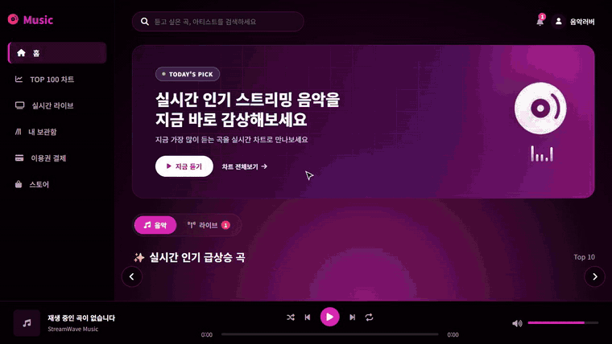
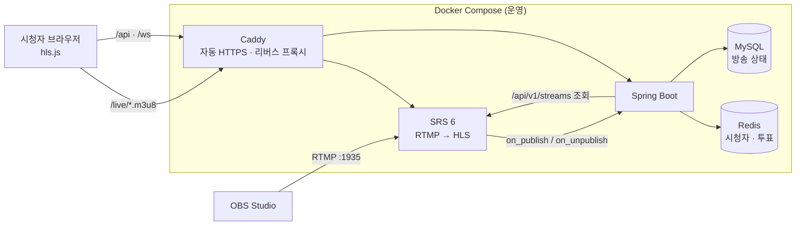
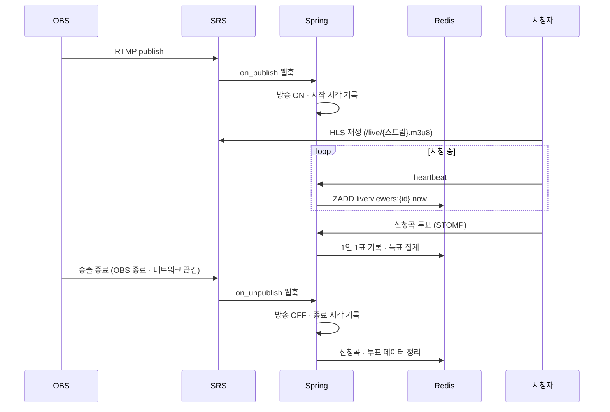
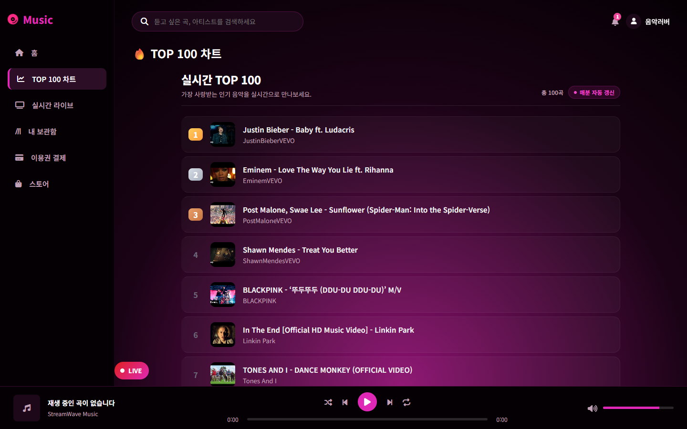
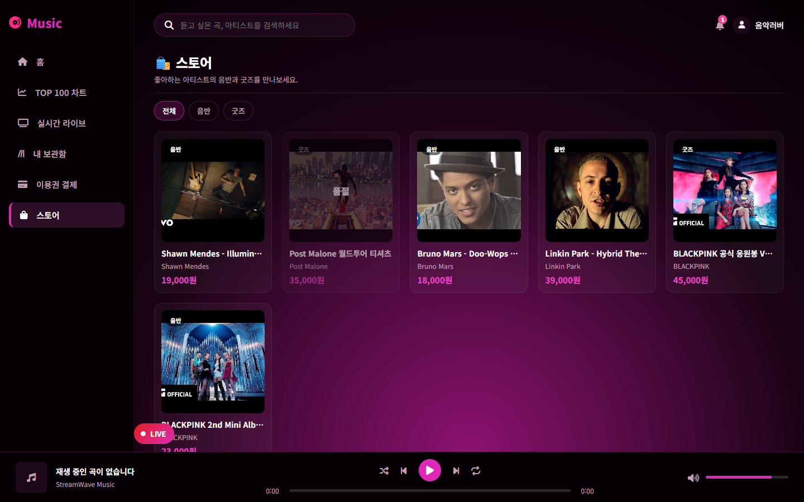
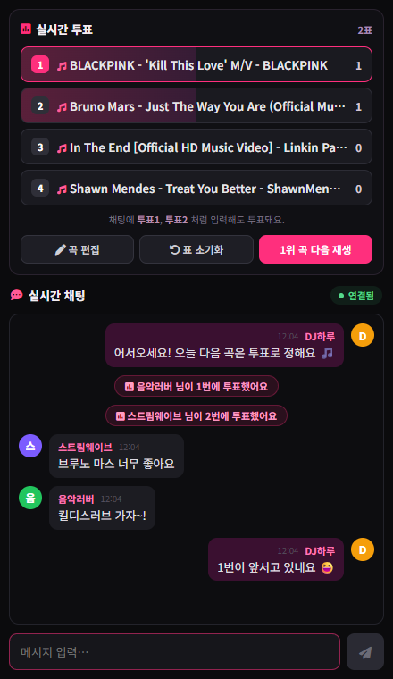
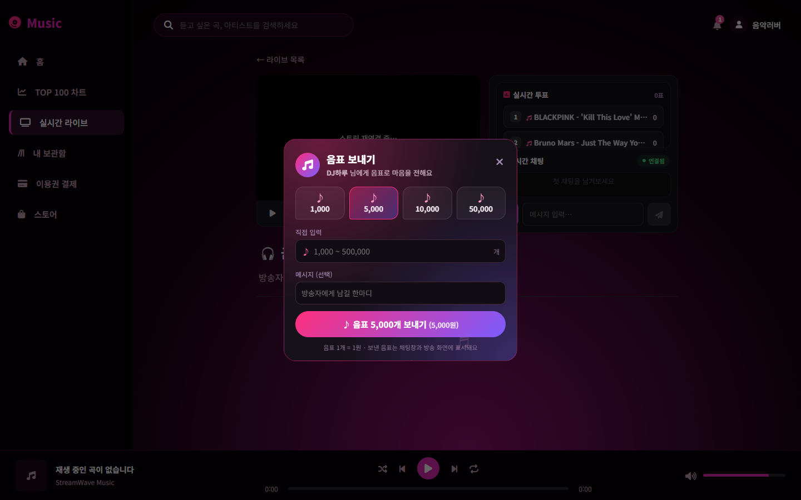
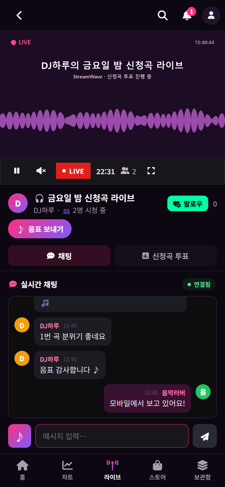
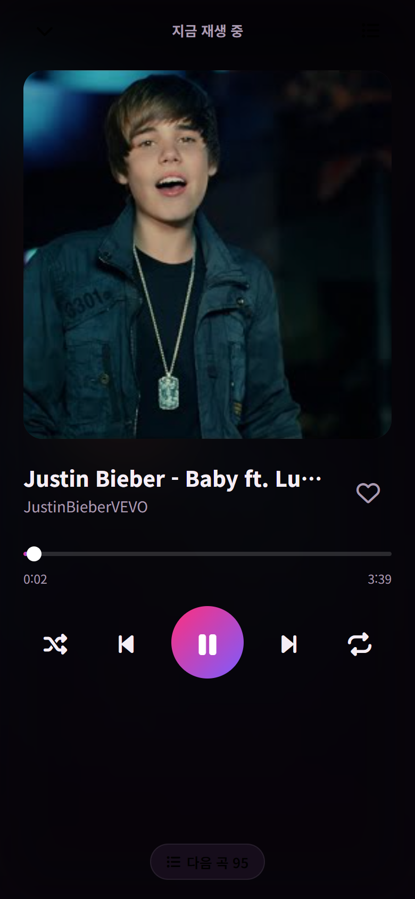

<div align="center">

<h1>🎧 StreamWave</h1>

**YouTube 음악 스트리밍과 라이브 방송을 한곳에서. 방송을 보며 신청곡에 투표하고, 음표로 응원하고, 듣던 곡의 음반까지 바로 사는 음악 플랫폼**


</div>

## 👥 개발자

| | 이름 | 담당 |
|:-:|:-:|---|
| <a href="https://github.com/JOJOJACK-cmyk"></a> | **박세영**<br />[@JOJOJACK-cmyk](https://github.com/JOJOJACK-cmyk) | **라이브 방송 서버 연동**(SRS RTMP → HLS, 송출 시작 · 종료 웹훅, 방송 상태 감지, Redis 시청자 수 집계), **라이브 상세 화면 · 채팅 · 신청곡 투표 초기 구현**, 인증 사용자 판별 로직, JPA 연관관계 · DB 제약 정리, Redis · S3 · YouTube 플레이어 초기 연동, **운영 배포 환경**(Docker Compose · Caddy) |
| <a href="https://github.com/cjsrudgh98-crypto"></a> | **천경호**<br />[@cjsrudgh98-crypto](https://github.com/cjsrudgh98-crypto) | 음악 스트리밍(YouTube 카탈로그 · 차트 · 검색 · 플레이어), 이용권 · 결제, 음표 후원, 스토어, 실시간 채팅 · 투표 고도화, 회원 · 관리자, 모바일 화면 등 서비스 전반 |

> 이 README는 **JOJOJACK이 맡은 부분**을 중심으로 정리했습니다. 서비스 전체 기능은 [서비스 한눈에 보기](#-서비스-한눈에-보기)에 요약했습니다.

<p align="center">
  
  <br />
  <sub>▲ 실제 서비스 화면 시연 (2배속) · 원본 영상: <a href="docs/demo/StreamWave-demo.mp4">StreamWave-demo.mp4</a> (2분 29초)</sub>
</p>

---

## 목차

- [내가 만든 것](#-내가-만든-것)
- [라이브 방송 구조](#-라이브-방송-구조)
- [기술적으로 고민한 부분](#-기술적으로-고민한-부분)
- [운영 배포 환경](#-운영-배포-환경)
- [내 커밋 기록](#-내-커밋-기록)
- [서비스 한눈에 보기](#-서비스-한눈에-보기)
- [기술 스택](#-기술-스택)
- [실행 방법](#-실행-방법)
- [프로젝트 구조](#-프로젝트-구조)

---

## 🙋‍♂️ 내가 만든 것

### 📡 1. 라이브 방송 서버 (SRS RTMP → HLS)

<table>
  <tr>
    <td width="55%"></td>
    <td>

OBS에서 보낸 방송을 시청자가 브라우저에서 볼 수 있도록 **미디어 서버를 처음부터 구성**했습니다.

- **SRS 6** 을 Docker Compose로 띄워 RTMP(1935)로 받고 HLS로 변환해 서빙
- `srs.conf` 작성: HTTP API, HLS 출력 경로, 조각 길이
- HLS 지연 단축: 조각 **2초 → 1초**, 재생목록 **10초 → 6초**
- 로컬 개발 시 SRS 포트(1935 · 1985 · 8081)를 **127.0.0.1에만 바인딩**
- 프론트: `hls.js`로 재생, Safari는 네이티브 HLS로 분기

    </td>
  </tr>
</table>

### 🔴 2. 방송 상태 감지 · 송출 웹훅

| 단계 | 구현 |
|---|---|
| **상태 조회** | `SrsLiveStatusService`가 SRS HTTP API(`/api/v1/streams/`)에서 `app=live`이고 `publish.active=true`인 스트림만 골라 **LIVE / OFFLINE / SRS_DOWN**을 판정 (`GET /api/live/status`) |
| **방송 목록** | 송출 중인 스트림 키와 DB 방송을 맞춰 라이브 목록을 만들고, 화면은 3초마다 갱신 |
| **송출 웹훅** | `SrsCallbackController`가 SRS의 `on_publish` / `on_unpublish` 호출을 받아 **방송 ON/OFF · 시작/종료 시각을 자동 동기화**하고, 종료 시 그 방송의 신청곡 · 투표 Redis 데이터를 정리 |
| **장애 격리** | SRS가 응답하지 않으면 라이브 목록 API가 500으로 죽지 않고 빈 목록을 반환 |
| **환경 분리** | HLS 주소(`hls.base-url`)와 SRS API 주소(`srs.api.base-url`)를 설정값으로 빼 로컬 · 운영을 같은 코드로 실행 |

> 이후 팀원이 공개용 재생 ID와 비밀 송출 키를 분리하고 `on_publish`에서 키를 검증하는 기능을 더했습니다.

### 👀 3. 실시간 시청자 수 (Redis heartbeat)

- `LiveViewerService`: 시청자가 보내는 heartbeat를 **Redis ZSET**(`live:viewers:{방송ID}`)에 `시청자ID → 현재 시각`으로 기록
- **15초** 동안 heartbeat가 없으면 `ZREMRANGEBYSCORE`로 제거하고 `ZCARD`로 인원을 셈. 키는 1분 TTL로 자동 정리
- 비로그인 시청자도 셀 수 있도록 heartbeat 경로만 공개하고, 방송 썸네일 필드를 추가

### 🗳 4. 라이브 상세 화면 · 채팅 · 신청곡 투표 (초기 구현)

| 기능 | 구현 |
|---|---|
| **라이브 상세 페이지** | `LiveDetailPage` · `LiveChat` · 투표 패널을 처음 만들어 방송 영상과 채팅 · 투표를 한 화면에 배치 |
| **WebSocket 경로 분리** | 기존 채팅(`/sub` · `/pub`)과 라이브 투표(`/topic` · `/app`)의 STOMP 경로를 나눠 서로 영향을 주지 않게 구성 |
| **1인 1표** | 방송 · 사용자별 투표 기록은 **Redis SET**, 곡 순위는 **ZSET**. 처음 투표한 곡에만 +1 |
| **방송자 권한** | "1위 곡 다음 재생"은 로그인 사용자가 **방송 소유자일 때만** 실행 |
| **방송 종료 정리** | `on_unpublish` 시 그 방송의 랭킹 · 투표 기록을 모두 삭제 |

> 화면 디자인과 채팅 관리 · 투표 UX는 이후 팀원이 고도화했습니다.

### 🔐 5. 인증 사용자 판별 · 인증/인가 응답

- `AuthenticatedUserResolver`: 일반 로그인과 **카카오(`kakao_account.email`) · 네이버(`response.email`) · 구글(`email`)** 의 서로 다른 principal 구조에서 이메일을 꺼내 **사용자 조회를 한 곳으로 통일**
- `CustomAuthenticationEntryPoint` / `CustomAccessDeniedHandler`로 **401 · 403을 JSON으로 일관되게 응답**
- CORS 허용 출처의 `*` · `null`을 제거하고 프론트 주소만 허용
- 프론트 `ProtectedRoute`로 로그인 필요 화면 보호

### 🗄 6. JPA 연관관계 · DB 제약

| 테이블 | 정리한 내용 |
|---|---|
| `tb_payment` | `order_id`, `payment_key` **유니크 제약** → 같은 결제의 중복 저장 방지, `user_id` 인덱스 |
| `tb_pass` | 사용자 `@ManyToOne(LAZY)` 연관관계, `(user_id, is_active, expire_date)` 인덱스로 유효 이용권 조회 |
| `listen_log` | `(user_id, music_id, listened_at)` 인덱스로 청취 기록 조회 |
| 공통 | 필수 컬럼 `nullable = false`, 컬럼명 명시 |

### ☁️ 7. Redis · S3 · YouTube 플레이어 초기 연동

- **Redis**: AOF(`appendonly yes`)로 재시작해도 데이터가 남는 Redis 구성, 음악 스냅샷 스케줄러와 청취 로그 기반 **TOP100 집계**의 첫 버전
- **AWS S3 + CloudFront**: 파일 업로드 API와 CloudFront URL 생성
- **YouTube IFrame 플레이어**: `YouTubePlayer` · `PlayerContext`로 재생/일시정지, 이전/다음, 셔플, 진행바 이동, 볼륨을 실제 YouTube 플레이어 상태와 연결

### 🚀 8. 운영 배포 환경

`docker compose -f docker-compose.prod.yml up -d --build` 한 줄로 **MySQL · Redis · SRS · Spring · Caddy**가 함께 뜨도록 구성했습니다. 자세한 내용은 [운영 배포 환경](#-운영-배포-환경)에 있습니다.

---

## 📡 라이브 방송 구조





---

## 💡 기술적으로 고민한 부분

<details>
<summary><b>1. 방송 상태를 "버튼"이 아니라 "실제 송출" 기준으로</b></summary>

- 처음에는 방송자가 API로 방송 시작/종료를 알려야 상태가 바뀌어서, **OBS만 끄거나 네트워크가 끊기면 목록에 방송이 계속 ON으로 남았습니다.**
- 1단계로 Spring이 SRS HTTP API를 조회해 실제 publish 중인 스트림만 LIVE로 판정했고(3초 폴링), 2단계로 SRS `http_hooks`의 **`on_publish` / `on_unpublish` 웹훅**을 받아 송출 시작 · 종료 순간에 DB 상태를 바로 동기화했습니다.
- 송출이 끊기는 시점에 그 방송의 신청곡 · 투표 Redis 데이터도 함께 지워, 다음 방송에 이전 투표가 남지 않게 했습니다.
</details>

<details>
<summary><b>2. 시청자 수: SRS 연결 수 대신 Redis heartbeat</b></summary>

- 처음에는 SRS 스트림의 `clients`에서 OBS 송출 연결 1개를 빼서 시청자 수로 썼습니다.
- 하지만 HLS는 짧은 HTTP 요청으로 조각 파일을 받아 가는 방식이라 **연결 수가 실제 시청자 수와 맞지 않았습니다.**
- SRS는 "어떤 방송이 켜져 있는지"만 판단하고, 시청자 수는 브라우저 heartbeat를 **Redis ZSET에 시각을 점수로 저장**해 셌습니다. 15초 넘게 소식이 없는 시청자는 점수 범위 삭제로 한 번에 정리하고, 아무도 보지 않는 키는 TTL로 사라지게 했습니다.
</details>

<details>
<summary><b>3. 미디어 서버 장애가 서비스 전체로 번지지 않게</b></summary>

- 라이브 목록 API가 SRS를 직접 조회하다 보니, SRS가 재시작 중이면 **라이브 페이지 전체가 500**이 됐습니다.
- SRS 연결 실패를 `IllegalStateException`으로 감싸고, 목록 API는 경고 로그만 남긴 채 **빈 목록**을 돌려주도록 바꿨습니다. 상태 API는 `SRS_DOWN`을 따로 알려 화면이 원인을 구분할 수 있습니다.
- `RestClient`를 필드에서 바로 만들면 `@Value` 주입 전이라 주소가 비는 문제가 있어, 생성자에서 설정값을 받아 만들도록 했습니다.
</details>

<details>
<summary><b>4. 신청곡 투표: Redis로 1인 1표 (초기 구현)</b></summary>

- 방송 · 사용자별 투표 기록은 SET, 곡 순위는 ZSET으로 나눴습니다. SET 추가가 성공한 경우에만 ZSET 점수를 올려, **같은 곡에 여러 번 눌러도 1표**만 반영됩니다.
- "1위 곡 다음 재생"은 WebSocket 메시지라도 서버에서 로그인 사용자와 **방송 소유자를 비교**해, 시청자가 방송자 플레이어를 조작하지 못하게 했습니다.
- 기존 채팅과 라이브 투표의 STOMP 구독 · 발행 경로를 분리해, 한쪽 변경이 다른 쪽에 영향을 주지 않게 했습니다.
- 이후 팀원이 방송자가 후보곡을 고르는 투표 방식과 채팅 `투표1` 연동으로 확장했습니다.
</details>

<details>
<summary><b>5. 로그인 방식마다 다른 사용자 정보 구조</b></summary>

- 일반 로그인은 principal이 문자열이지만, 카카오는 `kakao_account.email`, 네이버는 `response.email`, 구글은 `email`처럼 **OAuth2 제공자마다 이메일 위치가 달랐습니다.** 컨트롤러마다 이를 따로 처리하면 누락이 생깁니다.
- `AuthenticatedUserResolver` 한 곳에서 이메일을 추출하고 DB 사용자를 찾도록 통일했고, 실패하면 일관되게 `AccessDeniedException`을 던집니다.
- 401(로그인 필요)과 403(권한 없음)을 JSON 응답으로 구분해, 프론트가 로그인 화면 이동과 권한 안내를 나눠 처리할 수 있게 했습니다.
</details>

<details>
<summary><b>6. 결제 데이터 무결성은 DB에서도</b></summary>

- 애플리케이션 검증만으로는 새로고침 · 동시 요청 시 같은 결제가 두 번 저장될 수 있습니다.
- `order_id` · `payment_key`에 **유니크 제약**을 걸어 DB 수준에서 중복을 막고, 유효 이용권 조회 · 청취 기록 조회에 맞춘 **복합 인덱스**를 추가했습니다.
- 엔티티 간 관계를 `@ManyToOne(fetch = LAZY)`로 정리해 불필요한 조인을 줄였습니다.
</details>

<details>
<summary><b>7. 로컬과 운영의 차이를 설정으로 흡수</b></summary>

- 로컬에서는 SRS가 `host.docker.internal`로 백엔드를 불렀지만, 운영에서는 같은 Compose 네트워크의 **서비스명(`backend`, `srs`)** 으로 통신해야 했습니다. 운영용 `srs.prod.conf`와 `application-prod.properties`를 따로 두었습니다.
- HLS 주소 · SRS API 주소 · DB · Redis 주소를 모두 설정값으로 빼서, 코드 수정 없이 프로필(`SPRING_PROFILES_ACTIVE=prod`)만 바꿔 배포합니다.
- 리버스 프록시 뒤에서 원래 주소를 알 수 있도록 `forward-headers-strategy`를 켜고, HTTPS 환경에 맞춰 세션 쿠키를 `secure` · `http-only`로 설정했습니다.
</details>

---

## 🚀 운영 배포 환경

| 서비스 | 구성 |
|---|---|
| **mysql** | MySQL 8, 데이터 볼륨, healthcheck |
| **redis** | Redis 7 + AOF 영속화, 데이터 볼륨, healthcheck |
| **srs** | SRS 6, 운영 설정(`srs.prod.conf`) · 웹훅 · HLS · 썸네일 캡처, API 포트(1985)는 127.0.0.1에만 공개 |
| **backend** | Spring Boot 이미지(`backend/Dockerfile`), MySQL · Redis가 **healthy일 때 기동** |
| **caddy** | 프론트 빌드 결과(`frontend/Dockerfile`)를 서빙, `/api` · `/oauth2` · `/ws*` → Spring, `/live/*` → SRS(캐시 없음), **자동 HTTPS** |

```bash
cd ./-MUSIC-main/-MUSIC-main/music
cp .env.example .env   # 도메인, DB 비밀번호, API 키 등
docker compose -f docker-compose.prod.yml up -d --build
```

| 변수 | 용도 |
|---|---|
| `APP_HOST` | 서비스 도메인 (Caddy 자동 HTTPS · HLS 주소) |
| `MYSQL_ROOT_PASSWORD` | DB 비밀번호 |
| `YOUTUBE_API_KEYS` | YouTube API 키 (콤마로 여러 개) |
| `KAKAO_*`, `NAVER_*`, `GOOGLE_*` | OAuth 클라이언트 ID / 시크릿 |
| `MAIL_USERNAME`, `MAIL_PASSWORD` | 인증번호 메일 발송 |
| `AWS_*` | S3 업로드 / CloudFront |
| `TOSS_CLIENT_KEY`, `TOSS_SECRET_KEY` | 토스페이먼츠 |

> 이후 팀원이 SRS 웹훅 경로 외부 차단과 오류 응답 정리 등 운영 보안을 보강했습니다.

---

## 🧾 내 커밋 기록

| 날짜 | 커밋 | 내용 |
|---|---|---|
| 08-24 | [`e117060`](https://github.com/JOJOJACK-cmyk/-MUSIC-main2/commit/e117060) | SRS RTMP · HLS Docker Compose 구성 |
| 08-24 | [`d513b34`](https://github.com/JOJOJACK-cmyk/-MUSIC-main2/commit/d513b34) | SRS HLS 스트리밍 설정(`srs.conf`) |
| 08-24 | [`622d9c3`](https://github.com/JOJOJACK-cmyk/-MUSIC-main2/commit/622d9c3) | YouTube 음악 플레이어 연동 |
| 08-24 | [`7d53cd7`](https://github.com/JOJOJACK-cmyk/-MUSIC-main2/commit/7d53cd7) | AWS S3 파일 업로드 |
| 08-25 | [`c030447`](https://github.com/JOJOJACK-cmyk/-MUSIC-main2/commit/c030447) | Redis 음악 스냅샷 스케줄러 |
| 08-25 | [`28c2f19`](https://github.com/JOJOJACK-cmyk/-MUSIC-main2/commit/28c2f19) | Redis TOP100 · 청취 로그 · CloudFront · HLS 지연 단축 |
| 08-26 | [`8dc65fb`](https://github.com/JOJOJACK-cmyk/-MUSIC-main2/commit/8dc65fb) | SRS 포트를 localhost로 제한 |
| 08-27 | [`ce254bb`](https://github.com/JOJOJACK-cmyk/-MUSIC-main2/commit/ce254bb) | JPA 연관관계 · DB 제약 정리 |
| 08-28 | [`343e89b`](https://github.com/JOJOJACK-cmyk/-MUSIC-main2/commit/343e89b) | 영속 Redis 구성 · 인증 사용자 판별 |
| 08-28 | [`4cd12eb`](https://github.com/JOJOJACK-cmyk/-MUSIC-main2/commit/4cd12eb) | 라이브 방송 상태 감지 |
| 09-01 | [`9ca347d`](https://github.com/JOJOJACK-cmyk/-MUSIC-main2/commit/9ca347d) | 시청자 수 집계 · 썸네일 |
| 09-01 | [`1b0f535`](https://github.com/JOJOJACK-cmyk/-MUSIC-main2/commit/1b0f535) | 라이브 채팅 · 신청곡 투표 · 방송자 제어 |
| 09-02 | [`1fae88c`](https://github.com/JOJOJACK-cmyk/-MUSIC-main2/commit/1fae88c) | 인증 가드 · SRS 웹훅 연동 |
| 09-09 | [`dde1666`](https://github.com/JOJOJACK-cmyk/-MUSIC-main2/commit/dde1666) | 운영 배포 설정 (Docker Compose · Caddy · Dockerfile) |

---

## 🎵 서비스 한눈에 보기

음악은 혼자 듣기도 하지만, 누군가의 방송에서 함께 듣기도 합니다. **StreamWave**는 이 둘을 하나로 묶은 **팀 프로젝트**입니다.

| 영역 | 주요 기능 |
|---|---|
| 🎵 **음악 스트리밍** | YouTube 카탈로그 동기화, 실시간 TOP 100, 띄어쓰기 무관 검색, 재생 큐 · 셔플 · 반복, 좋아요 · 최근 들은 곡 · 플레이리스트 |
| 📡 **라이브 방송** | OBS 송출 → HLS 재생, 실시간 채팅, 신청곡 투표, 채팅 관리, OBS 오버레이 · 채팅 독, 미니 플레이어 · 방송 알림 |
| ♪ **음표 후원** | 1음표 = 1원, 결제 승인 시 채팅창 · OBS 오버레이 알림 |
| 💳 **이용권** | 라이트 · 스탠다드 · 프리미엄 등급별 기능, 토스페이먼츠 결제 |
| 🛍 **스토어** | 듣던 곡의 음반 · 굿즈, 주문 · 결제 · 환불, 관리자 상품 관리 |
| 🔐 **회원 · 관리자** | 이메일 가입 + 카카오 · 네이버 · 구글 로그인, 권한 3단계, 모바일 전용 화면 |

<table>
  <tr>
    <td align="center"><b>TOP 100 차트</b></td>
    <td align="center"><b>스토어</b></td>
    <td align="center"><b>OBS 채팅 독</b></td>
  </tr>
  <tr>
    <td></td>
    <td></td>
    <td align="center"></td>
  </tr>
  <tr>
    <td align="center"><b>음표 보내기</b></td>
    <td align="center"><b>모바일 라이브 시청</b></td>
    <td align="center"><b>모바일 전체화면 플레이어</b></td>
  </tr>
  <tr>
    <td></td>
    <td align="center"></td>
    <td align="center"></td>
  </tr>
</table>

<details>
<summary>시연 영상 순서 · 영상과 PDF를 다시 만드는 방법</summary>

1. 실시간 인기 급상승 곡 · 장르별 최신곡
2. 곡 · 아티스트 검색 → 바로 재생
3. 지금 듣는 곡의 음반 · 굿즈
4. 수량 · 배송지 입력 → 토스페이먼츠 결제창
5. 실시간 TOP 100
6. 라이브 방송 입장 (HLS 재생)
7. 신청곡 투표 (버튼 / 채팅 "투표1", 1인 1표)
8. 실시간 채팅
9. ♪ 음표로 방송자 응원
10. 좋아요 · 최근 들은 곡 · 플레이리스트
11. 이용권 등급
12. 관리자 스토어 관리
13. 모바일 전용 화면

- 영상: [`record-demo.mjs`](docs/demo/record-demo.mjs)가 실제 서버를 브라우저로 조작하며 녹화하고, [`make-video.mjs`](docs/demo/make-video.mjs)가 MP4 · GIF를 만듭니다.
- 라이브 영상: [`live-test-stream.mjs`](docs/demo/live-test-stream.mjs)가 ffmpeg 테스트 방송을 SRS와 같은 주소로 서빙합니다.
- 데이터: [`seed-demo.py`](docs/demo/seed-demo.py) · PDF: [`portfolio.html`](docs/portfolio/portfolio.html) → [`build-pdf.mjs`](docs/portfolio/build-pdf.mjs)

```bash
cd docs && npm install
python demo/seed-demo.py
npm run live                      # 테스트 방송 (다른 터미널)
npm run demo && npm run video     # 녹화 → MP4 / GIF
npm run pdf                       # 포트폴리오 PDF
```

</details>

---

## 🧰 기술 스택

| 영역 | 기술 |
|---|---|
| **Backend** | Java 25, Spring Boot 4.1 (Web, Data JPA, Security, OAuth2 Client, WebSocket/STOMP, Mail, Validation) |
| **Data** | MySQL 8, Redis (시청자 수 · 투표 · 차트 · 토큰) |
| **Live** | SRS 6 (RTMP → HLS), HTTP 웹훅, HTTP API, ffmpeg 썸네일, OBS, hls.js |
| **외부 연동** | YouTube IFrame · Data API, AWS S3 + CloudFront, 토스페이먼츠, Kakao · Naver · Google OAuth2 |
| **Frontend** | React 18, Vite 5, React Router 6, Axios, @stomp/stompjs + SockJS |
| **Infra** | Docker Compose (MySQL · Redis · SRS · Spring · Caddy), Caddy 자동 HTTPS |

---

## 🛠 실행 방법

### 요구 사항
- JDK 25, Node.js 18+, MySQL 8, Redis, Docker Desktop, OBS Studio (방송 테스트 시)

### 로컬 개발

```bash
# 1) DB
mysql -uroot -p -e "CREATE DATABASE music_db"

# 2) Redis
docker run -d --name music-redis -p 6379:6379 redis:7-alpine

# 3) SRS (라이브)
cd ./-MUSIC-main/-MUSIC-main/music/infra/srs && docker compose up -d
```

`backend/src/main/resources/application-secret.properties`에 DB 비밀번호, YouTube · OAuth · 메일 · 토스 키를 넣습니다. (git에 올라가지 않습니다)

```bash
# 4) 백엔드  → http://localhost:8080
cd ./-MUSIC-main/-MUSIC-main/music/backend && ./mvnw spring-boot:run

# 5) 프론트엔드 → http://localhost:3000
cd ./-MUSIC-main/-MUSIC-main/music/frontend && npm install && npm run dev
```

### OBS 방송 테스트

| 항목 | 값 |
|---|---|
| 서버 | `rtmp://localhost/live` |
| 스트림 키 | 프로필 → **스튜디오**에서 발급한 키 그대로 (`pb_…?key=live_…`) |

| 포트 | 용도 |
|---|---|
| 1935 | RTMP 송출 |
| 1985 | SRS HTTP API (로컬 전용) |
| 8081 | HLS 재생 |
| 8080 | Spring Boot |
| 3000 | Vite 개발 서버 |

---

## 📁 프로젝트 구조

⭐ 표시는 JOJOJACK이 만들거나 주로 작업한 부분입니다.

```
-MUSIC-main/-MUSIC-main/music
├── backend/src/main/java/com/example/music/
│   ├── controller/
│   │   ├── SrsCallbackController     ⭐ SRS on_publish / on_unpublish 웹훅
│   │   ├── LiveStatusController      ⭐ 방송 상태 조회
│   │   └── BroadcastController       ⭐ 라이브 목록 · 시청자 heartbeat · 투표 메시지 (공동)
│   ├── service/
│   │   ├── SrsLiveStatusService      ⭐ SRS HTTP API 연동
│   │   ├── LiveViewerService         ⭐ Redis 시청자 수
│   │   ├── BroadcastService          ⭐ 방송 상태 동기화 (공동)
│   │   └── SongVoteService           ⭐ 신청곡 투표 (공동)
│   ├── security/
│   │   └── AuthenticatedUserResolver ⭐ 로그인 방식별 사용자 판별 (공동)
│   ├── entity/                       ⭐ Payment · Pass · ListenLog 연관관계 · 제약
│   └── config/  dto/  repository/  scheduler/
├── frontend/src/
│   ├── pages/LivePage · LiveDetailPage   ⭐ 라이브 목록 · 상세 (공동)
│   └── components/LiveChat · YouTubePlayer · HlsAudioPlayer   ⭐ 초기 구현
├── infra/
│   ├── srs/srs.conf · srs.prod.conf  ⭐ RTMP → HLS · 웹훅 · 썸네일
│   ├── srs/docker-compose.yml        ⭐ 로컬 SRS
│   └── caddy/Caddyfile               ⭐ 리버스 프록시 · 자동 HTTPS
├── backend/Dockerfile · frontend/Dockerfile   ⭐
└── docker-compose.prod.yml           ⭐ MySQL · Redis · SRS · Spring · Caddy
docs/
├── demo/          # 시연 영상(MP4 · GIF) + 녹화 스크립트
├── portfolio/     # 포트폴리오 PDF
└── screenshots/   # README 화면
```

---

<div align="center">

**StreamWave**: 듣고, 함께 듣고, 응원하세요 🎧

</div>
